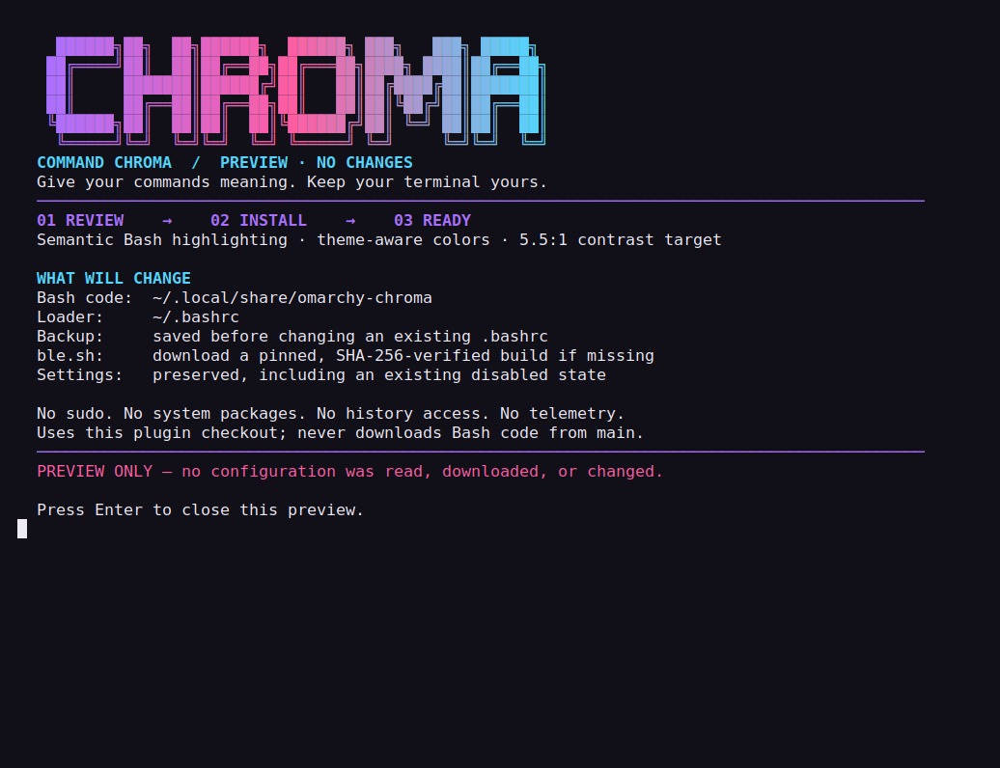
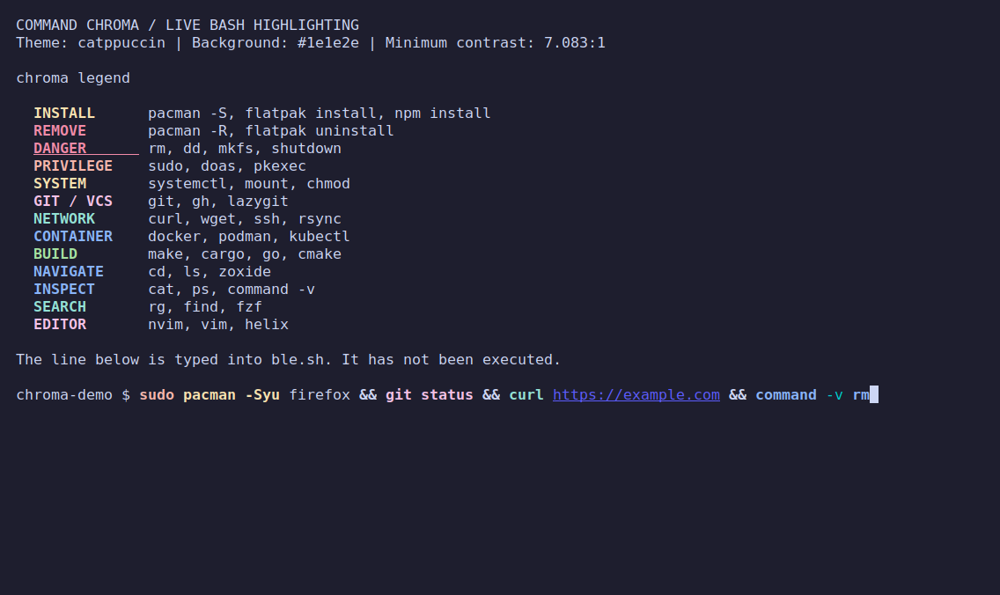
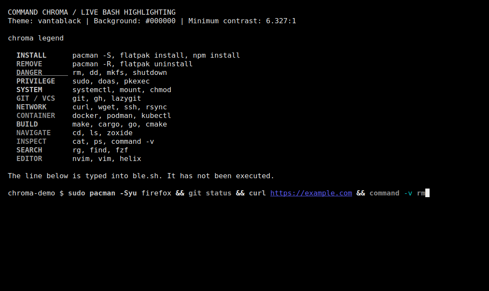
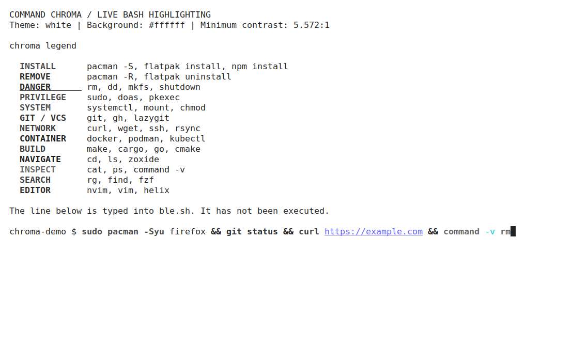
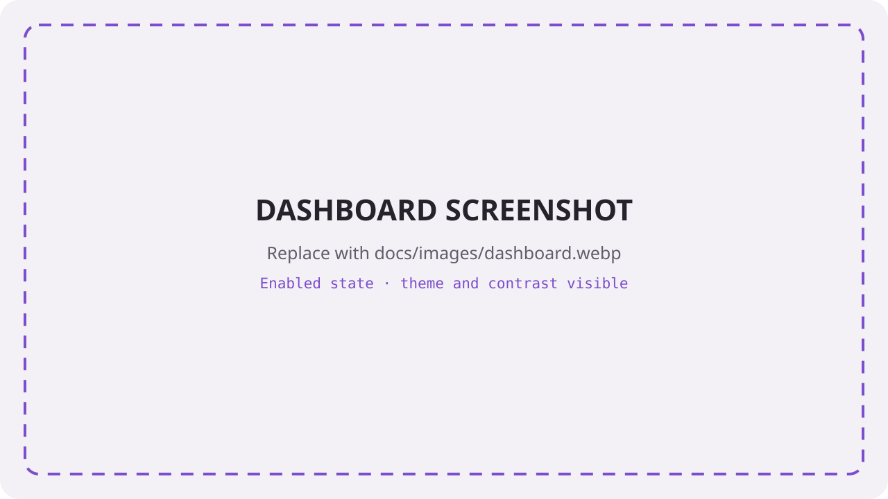

# Omarchy Chroma Studio

**A complete Styling Centre for the entire Omarchy system.**

Not just a plugin — a learning platform, a theme laboratory, and your personal AI stylist. Chroma teaches you how to customize Omarchy, doesn't just throw a plugin interface at you.

---

## Quick Start

```bash
# Via Omarchy Plugin Manager (recommended)
omarchy plugin add https://github.com/itsVoid-TV/Omarchy-Chroma.git --enable

# Or standalone (no Omarchy widget needed)
git clone https://github.com/itsVoid-TV/Omarchy-Chroma.git
cd Omarchy-Chroma
bash install.sh
```

Click the **Chroma icon** in your bar → **Set up in terminal** → follow the animated English installer. Open a new Bash terminal and run `chroma doctor`.

---

## What You Get

| Component | Purpose |
|-----------|---------|
| **Semantic Bash Highlighting** | Colors commands by *what they do* (install=yellow, remove=red, danger=bright red+underline, git=purple, network=cyan, containers=blue, build=green, navigate=blue-green, inspect/search/editors=variants) |
| **Theme-Aware Contrast** | Follows your active Omarchy `colors.toml`, lifts faint colors to **≥5.5:1** contrast automatically |
| **Native Control Panel** | Qt/Quickshell dashboard in your bar: status, theme info, contrast, Doctor, Legend, Enable/Disable, Reload, Uninstall |
| **Interactive Lessons** | Step-by-step guides built into the README and the **Learn** tab — from "Install your first theme" to "Build a custom plugin" |
| **Knowunity-Style Library** | A searchable, taggable collection of lessons, snippets, and community themes — parked right in the dashboard |
| **🎨 Chroma Stylist (AI)** | Detects local AI runtimes (OpenCode, Codex, Claude Code, Oh My Posh, Ollama, LM Studio) and opens a prompt interface. Under the hood: a local AI with a specialized skill to **generate themes, write configs, craft plugins, debug highlighting rules** — no cloud, no API keys |

---

## Screenshots

### English Terminal Installer (animated, safe preview mode)



*Run `./setup --preview` to reproduce this exact capture.*

### Live Semantic Highlighting (Catppuccin theme)



*Real Bash + pinned ble.sh, typed live. `chroma legend` output shown above.*

<details>
<summary>Monochrome theme stress tests</summary>

 

*Managed foregrounds meet 5.5:1; ble.sh syntax (URLs, etc.) uses its own styles.*
</details>

### Control Panel (Qt, dark sample data)


*Also available: [Light](docs/images/dashboard-light-preview.png) · [First Run](docs/images/dashboard-first-run-preview.png)*

### Native Omarchy Desktop — *your screenshot here*



**Help us complete this:** Open Chroma in your Omarchy bar, take a screenshot, save as `docs/images/omarchy-desktop.webp`. See [image checklist](docs/images/README.md).

---

## Architecture Overview

```
┌─────────────────────────────────────────────────────────────┐
│                    OMARCHY CHROMA STUDIO                    │
├─────────────────────────────────────────────────────────────┤
│  ┌──────────────┐  ┌──────────────┐  ┌──────────────────┐  │
│  │  SEMANTIC    │  │   THEME      │  │   CHROMA         │  │
│  │  HIGHLIGHT   │  │   ENGINE     │  │   STYLIST (AI)   │  │
│  │  (Bash/ble)  │  │  (awk/ble)   │  │  (local runtime) │  │
│  └──────┬───────┘  └──────┬───────┘  └────────┬─────────┘  │
│         │                 │                     │           │
│         ▼                 ▼                     ▼           │
│  ┌──────────────────────────────────────────────────────┐  │
│  │              CONTROL PANEL (Qt/Quickshell)           │  │
│  │  Status · Theme · Contrast · Doctor · Legend · Learn │  │
│  │  Enable/Disable · Reload · Uninstall · Stylist       │  │
│  └──────────────────────────────────────────────────────┘  │
│                          │                                  │
│         ┌────────────────┼────────────────┐                │
│         ▼                ▼                ▼                │
│  ┌──────────┐     ┌──────────┐     ┌──────────┐           │
│  │  LESSONS │     │  LIBRARY │     │  SNIPPETS│           │
│  │  (Learn) │     │ (Knowunity)│   │ (Quick)  │           │
│  └──────────┘     └──────────┘     └──────────┘           │
└─────────────────────────────────────────────────────────────┘
```

---

## The Three Pillars

### 1. Semantic Command Highlighting (The Core)

Chroma colors what a command **does** while you type — not just syntax.

| Category | Color | Examples |
|----------|-------|----------|
| **Install / Update** | Yellow, bold | `pacman -Syu`, `flatpak install`, `npm install` |
| **Remove** | Coral red, bold | `pacman -Rns`, `flatpak uninstall`, `docker rm` |
| **Dangerous** | Bright red, bold, **underlined** | `rm`, `dd`, `mkfs`, `git reset --hard`, forced pushes |
| **Privileged** | Orange, bold | `sudo`, `doas`, `pkexec` |
| **System** | Amber | `systemctl`, `mount`, `chmod` |
| **Git / VCS** | Purple, bold | `git`, `gh`, `lazygit` |
| **Network** | Cyan | `curl`, `wget`, `ssh`, `rsync` |
| **Containers** | Blue | `docker`, `podman`, `kubectl` |
| **Build / Runtime** | Green | `make`, `cargo`, `go`, `node` |
| **Navigate / Inspect / Search / Editors** | Blue-green variants | `cd`, `bat`, `rg`, `nvim` |

**Wrapper-aware:** `sudo env LANG=C pacman -Syu firefox && git status` → `sudo` (orange) + `pacman -Syu` (yellow) + `git status` (purple).

**Commands:** `chroma legend`, `chroma doctor`, `chroma explain 'cmd'`, `chroma reload`, `chroma version`.

---

### 2. Lessons & Library (The Learning Layer)

**GitHub README = Lesson Book** — every major feature has a "Lesson" section with prerequisites, steps, verification, and troubleshooting.

**Knowunity-Style Library** (in the Control Panel's **Learn** tab):
- **Searchable**, **taggable** (theme, plugin, config, scripting, ai)
- **Community submissions** via PR — lessons, snippets, theme recipes
- **Progress tracking** — mark lessons complete, see what's next
- **Offline-first** — bundled with the plugin, works without internet

**Example Lessons:**
- `L01` Install & verify Chroma
- `L02` Read & write `config.bash` (custom styles, extra commands)
- `L03` Build a custom Omarchy theme (colors.toml + theme.name)
- `L04` Write a semantic highlight rule for your CLI tool
- `L05` Create an Omarchy plugin from scratch
- `L06` Use the Chroma Stylist to generate a theme
- `L07` Debug highlighting with `chroma doctor` / `chroma explain`

---

### 3. 🎨 Chroma Stylist — Your Local AI Theme Engineer

**The Stylist detects what's callable on your machine:**

| Runtime | Detection | Use Case |
|---------|-----------|----------|
| **OpenCode** | `opencode` in PATH, local provider configured | Full agentic editing, file ops, git |
| **Codex** | `codex` in PATH | OpenAI Codex CLI, local reasoning |
| **Claude Code** | `claude` in PATH | Anthropic's coding agent |
| **Oh My Posh** | `omp` in PATH | Prompt/theme generation |
| **Ollama** | `ollama` + model pulled | Fully local LLM (llama3.2, qwen2.5-coder, etc.) |
| **LM Studio** | `lms` or API on 127.0.0.1:1234 | Local model server with UI |
| **Antigravity** | `antigravity` in PATH | Local agent runtime |

**No runtime?** The Stylist tells you exactly what to install:
```bash
# OpenCode (no account, fully local)
curl -fsSL https://opencode.ai/install | bash

# Ollama + a coder model
curl -fsSL https://ollama.com/install.sh | sh
ollama pull qwen2.5-coder:7b
```

**What the Stylist can do (via specialized local skill):**
- 🎨 **Generate complete Omarchy themes** (`colors.toml` + `theme.name`) from a description ("warm sunset, high contrast, catppuccin-inspired")
- ⚙️ **Write `config.bash`** with custom `CHROMA_STYLES`, extra command arrays, tuned contrast
- 🔌 **Scaffold Omarchy plugins** (manifest.json, BarWidget.qml, install.sh, Backend.qml, Model.js)
- 🐛 **Debug highlighting rules** — paste a command, get `chroma explain` output + fix suggestions
- 📝 **Write lessons/snippets** for the Library in the Knowunity format
- 🔄 **Migrate configs** between Omarchy versions

**Privacy:** 100% local. No telemetry. No cloud API keys. Your terminal input never leaves your machine.

---

## Installation Details

### Omarchy Plugin (Widget + Bash)

```bash
omarchy plugin add https://github.com/itsVoid-TV/Omarchy-Chroma.git --enable
```
- Adds the **Chroma widget** to your bar (Quickshell/Qt)
- **Does not** install Bash integration automatically — click **Set up in terminal** in the panel
- The terminal installer reviews `.bashrc` changes, backs up, asks for explicit `y`
- After install: open new terminal → `chroma doctor`

### Standalone Bash (No Widget)

```bash
git clone https://github.com/itsVoid-TV/Omarchy-Chroma.git
cd Omarchy-Chroma
bash install.sh
```
- Installs `chromarchy.bash`, `lib/*`, `config/defaults.bash` to `~/.local/share/omarchy-chroma/`
- Adds one marked loader block to `~/.bashrc`
- Preserves existing config, symlinked `.bashrc`, downloads pinned `ble.sh` (8 MiB, SHA-256 verified)
- Run `chroma doctor`, `chroma legend` in a new terminal

### Safe Preview (Zero Changes)

```bash
./setup --preview
```
Shows the animated installer, sample review screen, and what *would* happen — no config reads, no downloads, no writes.

---

## Configuration

Edit `~/.config/omarchy-chroma/config.bash`:

```bash
# Custom semantic styles (always win, not adjusted by contrast guard)
CHROMA_STYLES[install]='fg=yellow,bold'
CHROMA_STYLES[danger]='fg=white,bg=red,bold,underline'

# Opt-in ble.sh ghost-text suggestions (default: off)
CHROMA_SUGGESTIONS=1

# Opt-in ble.sh red error overlays + exit marker (default: off)
CHROMA_BLE_ERROR_FEEDBACK=1

# Enter submits complete multiline (default: on)
CHROMA_ENTER_ACCEPT=1

# Theme integration & contrast target (default: on, 5.5)
CHROMA_THEME_INTEGRATION=1
CHROMA_MIN_CONTRAST=5.5

# Extend command classification
CHROMA_EXTRA_INSTALL_COMMANDS+=(my-installer)
CHROMA_EXTRA_REMOVE_COMMANDS+=(my-uninstaller)
CHROMA_EXTRA_DANGER_COMMANDS+=(my-disk-wiper)
```

**Open a new terminal after changes.** Invalid settings fall back safely and are reported by `chroma doctor`.

---

## Update / Uninstall

**Plugin (Git-managed):**
```bash
omarchy plugin update io.github.itsvoid-tv.command-chroma
# Review diff, confirm, then: Set up in terminal if Bash update reported
```

**Standalone (ZIP or Git):**
```bash
# ZIP: download fresh main.zip, extract, run bash install.sh
# Git: git pull --ff-only && bash install.sh
```

**Uninstall Bash integration:**
```bash
~/.local/share/omarchy-chroma/uninstall.sh
# Add --purge to remove user config too (ble.sh is kept)
```

**Remove widget:**
```bash
omarchy plugin remove io.github.itsvoid-tv.command-chroma
```

---

## Troubleshooting

```bash
chroma doctor
```
Should show:
- Omarchy theme, exact background color
- Worst contrast ≥ 5.500
- Valid config, healthy `.bashrc` loader
- `semantic layer: ready`, `render layer: registered`
- `red error feedback: disabled`

**Force theme refresh:**
```bash
chroma reload
```

**Stuck on old version after update:**
```bash
exec bash
```

**Input behaving oddly — clean recovery shell:**
```bash
bash --norc
# Then uninstall or comment the omarchy-chroma block in ~/.bashrc
```

**Empty line above first prompt:** Starship's `add_newline = true`. Fix in `~/.config/starship.toml`:
```toml
add_newline = false
```

---

## Design & Privacy

- Reads `~/.local/state/omarchy/current/theme/colors.toml` as **data** — never sourced/executed
- Built for Omarchy's Bash init — doesn't switch your login shell
- Semantic layer **after** `ble.sh` syntax/error highlighting
- Uses `ble.sh`'s fzf adapter — Omarchy completion/history shortcuts kept
- **No `eval`**, no subprocess per keystroke, no telemetry, no network while typing
- **No OpenAI API key needed** — deterministic local classification
- User changes stay in `~/.bashrc` / `~/.config` — `/usr/share/omarchy` never modified
- Follows Omarchy Bash config, `cd`/`zd` alias, dotfiles guidance, official `ble.sh` extension model

---

## Development

```bash
bash tests/run.bash
```

**Suite covers:**
- Semantic parsing, wrapper options, ordered render ranges, operators, quotes, redirections, comments
- Config recovery, atomic installation, malformed marker preservation, symlinked `.bashrc`
- Uninstall, ShellCheck
- **Every theme** from pinned Omarchy revision — actual RGB/ANSI render in PTYs (Vantablack + White)
- Reproduces Omarchy's output-producing `cd` alias, verifies silent startup without red overlays
- Plugin bridge: explicit consent, no-write inspection, `.bashrc` backups, idempotent setup, symlink preservation, lifecycle actions, concurrency, timeouts, palette errors, missing deps
- Node tests: pure UI model
- Set `CHROMA_QMLTESTRUNNER` to Qt 6 `qmltestrunner` for ControlView confirmation/keyboard/dark/light/narrow tests

---

## Roadmap (v0.5 → v1.0)

- [ ] **Chroma Stylist v1** — local AI runtime detection + prompt interface (OpenCode, Ollama, LM Studio, Codex, Claude Code)
- [ ] **Knowunity Library UI** — searchable lessons/snippets in ControlView Learn tab
- [ ] **Lesson Progress** — local completion tracking, "next lesson" suggestions
- [ ] **Theme Gallery** — browse/install community themes from the panel
- [ ] **Plugin Scaffold** — Stylist generates complete plugin boilerplate
- [ ] **Highlighting Rule Builder** — visual rule editor in the Stylist chat
- [ ] **Multi-language Docs** — DE/ES/FR/JA translations for lessons
- [ ] **Native Wayland/Omarchy Smoke Test** — CI on real hardware

---

## License

MIT. `ble.sh` is a separate BSD-3-Clause dependency and is not vendored.

---

## Credits

- **Omarchy** by [@basecamp](https://github.com/omacom/omarchy) — the opinionated Arch Linux experience
- **ble.sh** by [@akinomyoga](https://github.com/akinomyoga/ble.sh) — the Bash line editor that makes this possible
- **ttfx** by [@omacom](https://github.com/omacom/ttfx) — the text animation engine
- **Quickshell** — the Qt/QML shell powering Omarchy's bar
- **Community themes & feedback** — you know who you are

---

**Made with ☕ and 🎨 by [@itsVoid-TV](https://github.com/itsVoid-TV)**

*Omarchy Chroma Studio — because your terminal deserves a stylist.*