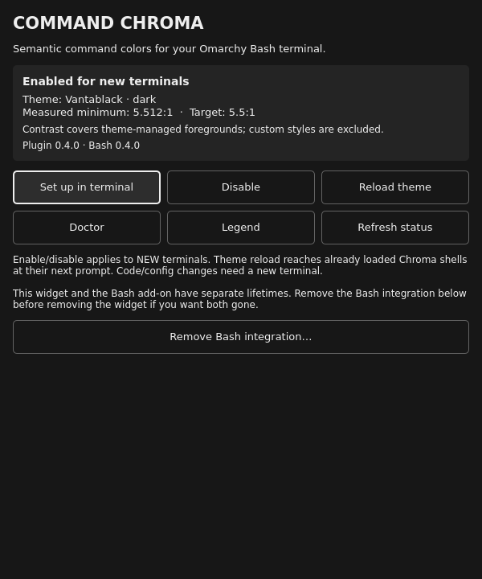

# Omarchy Chroma Studio — The Styling Centre for Your Entire Omarchy System

> **New name, same soul.** Formerly *Command Chroma / Omarchy Chroma*. Commands, config paths,
> and the plugin ID stay compatible — only the project identity grew up.

Theme-aware semantic Bash command highlighting for **Omarchy**, an animated English terminal
installer, readable contrast, diagnostics, a native Quattro control panel — and now a
**styling centre** that teaches you how to make Omarchy truly yours.

Plugin 0.4.3 is available from `main`. Marketplace-verified by `@Hancore_Linux`.



---

## How to read this README

This is not a wall of features. It is a **mini-course with chapters**. Read them in order,
or **skip any chapter** — every chapter is self-contained and links back to the table of
contents. If you only want the Bash highlighting, jump straight to
[Chapter 6](#chapter-6--command-highlighting-chroma).

**Table of contents**

- [Chapter 0 — Quick start (60 seconds)](#chapter-0--quick-start-60-seconds)
- [Chapter 1 — How Omarchy styling works](#chapter-1--how-omarchy-styling-works)
- [Chapter 2 — Switching & installing themes](#chapter-2--switching--installing-themes)
- [Chapter 3 — Making your own theme](#chapter-3--making-your-own-theme)
- [Chapter 4 — `.config` & dotfiles](#chapter-4--config--dotfiles)
- [Chapter 5 — Plugins & bar widgets](#chapter-5--plugins--bar-widgets)
- [Chapter 6 — Command highlighting (Chroma)](#chapter-6--command-highlighting-chroma)
- [Chapter 7 — AI Stylist (local agent)](#chapter-7--ai-stylist-local-agent)
- [Chapter 8 — Troubleshooting & recovery](#chapter-8--troubleshooting--recovery)

---

## Chapter 0 — Quick start (60 seconds)

Add and enable the plugin:

```bash
omarchy plugin add https://github.com/itsVoid-TV/Omarchy-Chroma.git --enable
```

Click the Chroma logo in your bar → **Set up in terminal**. The English installer reviews
the Bash changes and asks for confirmation. Open a new Bash terminal and run:

```bash
chroma doctor
```

> Omarchy's add command clones and enables the widget; it deliberately does **not** execute
> install hooks. Adding the widget alone never changes `.bashrc`.

**Alternative (ZIP):** download the
[main ZIP](https://github.com/itsVoid-TV/Omarchy-Chroma/archive/refs/heads/main.zip),
extract it, open a terminal inside, and run `./setup` (or `python3 setup` if permissions
were stripped). Already have the checkout? Run `./setup --bash`.

> **ZIP installs:** `omarchy plugin update` does **not** apply to a ZIP snapshot. If you
> installed from ZIP, first remove the widget with
> `omarchy plugin remove io.github.itsvoid-tv.command-chroma`. Then add the Git-managed install with
> `omarchy plugin add https://github.com/itsVoid-TV/Omarchy-Chroma.git --enable`.

**Safe preview (no changes):** `./setup --preview`

Skip to: [Chapter 6](#chapter-6--command-highlighting-chroma) if you only want highlighting.

---

## Chapter 1 — How Omarchy styling works

Omarchy is an **omakase** system: one theme restyles *everything* — desktop, terminal,
Neovim, btop, Chromium, top bar, notifications, lock screen. There is no “settings panel”
for colours; there is a single source of truth.

**The chain:**

```
~/.local/state/omarchy/current/theme/colors.toml   (active theme)
        │
        ├── terminal (foot/ghostty/alacritty/kitty)
        ├── Neovim / btop / starship
        ├── top bar & notifications (Quickshell)
        └── lock screen
```

- Switch themes: `Super + Shift + Ctrl + Space` (live preview) or
  `omarchy-theme-set <name>`.
- Cycle wallpapers only: `Super + Ctrl + Space`.
- Community themes: `omarchy-theme-install <git-url>` — filtered at install time so a
  theme can only ship colours and wallpapers, never Lua or terminal configs.

**Key idea:** styling Omarchy is mostly **editing files**, not clicking. That is a feature,
not a bug — your agent (or you) can read, diff, and version every change.

→ Skip to [Chapter 3](#chapter-3--making-your-own-theme) to build your own, or
[Chapter 4](#chapter-4--config--dotfiles) for dotfiles.

---

## Chapter 2 — Switching & installing themes

**Bundled themes (22):** tokyo-night, catppuccin, catppuccin-latte, lumon, ethereal,
everforest, gruvbox, miasma, hackerman, jade-horse, kanagawa, nord, matte-black,
vantablack, ristretto, retro-82, flexoki-light, rose-pine, osaka-jade, last-horizon,
lupine, solitude, white.

**Community themes:** browse [omarchythemes.com](https://omarchythemes.com/) or the
[Omarchy Hub](https://omarchy.deepakness.com/themes). Install with one command:

```bash
omarchy-theme-install https://github.com/<user>/omarchy-<name>-theme
omarchy-theme-update   # keep them fresh
```

**Security note:** on Omarchy **4.0.1+**, a theme installed with `omarchy-theme-install`
has its Lua, terminal and `vscode.json` files filtered when it is staged. Upgrade to
4.0.1 or newer before installing community themes. A theme is colours + wallpapers only.
Downloaded theme files remain untrusted. Review them before you copy any file into a
local theme: a copy has no `.git` directory, so Omarchy stages it without the filter.


→ Skip to [Chapter 5](#chapter-5--plugins--bar-widgets) for plugins.

---

## Chapter 3 — Making your own theme

A theme is just a folder: `~/.config/omarchy/themes/<name>/` with colour files plus a
`backgrounds/` folder.

**The easy path:**

1. Copy an existing theme:
   ```bash
   cp -r /usr/share/omarchy/themes/tokyo-night ~/.config/omarchy/themes/my-theme
   ```
2. Set the terminal palette in `colors.toml`. Edit the other colour files (btop,
   notifications, bar, lock screen) and drop wallpapers into `backgrounds/`.
3. Reopen the theme menu — your theme appears instantly.
4. Publish on GitHub; anyone installs it with `omarchy-theme-install`. Installs drop
   terminal configs, which are regenerated from `colors.toml`.

**What Chroma adds:** it reads `colors.toml` as *data* (never sourced), lifts faint
colours to a 5.5:1 contrast target, and reports the worst contrast in `chroma doctor`.
Your explicit `CHROMA_STYLES[...]` overrides always win.

→ Skip to [Chapter 4](#chapter-4--config--dotfiles) for dotfiles.

---

## Chapter 4 — `.config` & dotfiles

Omarchy keeps user changes in `~/.config` and `~/.bashrc`; `/usr/share/omarchy` is never
modified. The places you will actually edit:

| File | What it controls |
|---|---|
| `~/.config/hypr/input.lua` | keyboard layout, keybinds |
| `~/.config/hypr/monitors.lua` | display scale, multi-monitor |
| `~/.config/starship.toml` | prompt (`add_newline = false` removes the empty first line) |
| `~/.config/omarchy-chroma/config.bash` | Chroma styles, toggles, extra commands |
| `~/.bashrc` | one marked Chroma block (managed) |

**Tips:**
- Edit configs with your editor (`nvim`); Omarchy’s `cd`/`zd` aliases make navigation fast.
- Use `hyprctl reload` to apply Hyprland changes live.
- Backups live in `${XDG_STATE_HOME:-~/.local/state}/omarchy-chroma/backups`.

→ Skip to [Chapter 6](#chapter-6--command-highlighting-chroma) for highlighting.

---

## Chapter 5 — Plugins & bar widgets

Omarchy has no “store” — it has a built-in install menu, the full AUR, and a clean
plugin model.

```bash
omarchy plugin add <git-url> --enable
omarchy plugin update <plugin-id>
omarchy plugin remove <plugin-id>
```

> After `omarchy plugin update`, the Git checkout changes but the installed Bash
> integration stays at the previous version. Open the Chroma dashboard and run
> **Set up in terminal** if it reports a Bash update, confirm the setup, then open a
> new terminal. Run `chroma version` to check the loaded version.

**Chroma is one such plugin:** the logo opens a Qt control panel with install/enabled
status, theme info, contrast, and actions (Set up in terminal, Enable/Disable, Reload
theme, Doctor, Legend). Adding the widget alone never changes `.bashrc`.

**Community plugins:** browse the
[Omarchy Plugin Marketplace](https://plugins.omarchy.org/) or
[Omarchy Hub](https://omarchy.deepakness.com/plugins).

→ Skip to [Chapter 7](#chapter-7--ai-stylist-local-agent) for the AI Stylist.

---

## Chapter 6 — Command highlighting (Chroma)

Chroma colours what a command *does* while you type:

| Meaning | Role | Examples |
|---|---|---|
| Install / update | Yellow, bold | `pacman -Syu`, `npm install` |
| Remove | Coral red, bold | `pacman -Rns`, `docker rm` |
| Dangerous | Bright red, bold, underlined | `rm`, `dd`, `git reset --hard` |
| Privileged | Orange, bold | `sudo`, `doas` |
| Git / VCS | Purple, bold | `git`, `gh`, `lazygit` |
| Network | Cyan | `curl`, `wget`, `ssh` |
| Containers | Blue | `docker`, `podman`, `kubectl` |
| Build / runtime | Green | `make`, `cargo`, `node` |

It works in Foot, Ghostty, Alacritty, Kitty and others because the feature lives in Bash,
not in one terminal. `ble.sh` emits exact 24-bit colour where supported.

**Commands**

| Command | Purpose |
|---|---|
| `chroma legend` | Show every semantic colour |
| `chroma doctor` | Check ble.sh, paste, theme, contrast, `.bashrc` |
| `chroma explain COMMAND...` | Print token categories without executing |
| `chroma reload` | Reload the Omarchy palette |
| `chroma version` | Print the loaded version |

**Customise** via `~/.config/omarchy-chroma/config.bash`:

```bash
CHROMA_STYLES[install]='fg=yellow,bold'
CHROMA_EXTRA_DANGER_COMMANDS+=(my-disk-wiper)
CHROMA_MIN_CONTRAST=5.5
CHROMA_ENTER_ACCEPT=0   # restore upstream Enter behaviour
```

Open a new terminal after changing config. Invalid values fall back safely and are listed
by `chroma doctor`.


---

## Chapter 7 — AI Stylist (local agent)

> **Coming next.** A local AI agent that applies styling for you — no cloud account needed.

**Idea:** you type a prompt (“dark minimalist theme, blue accents, matching bar”), and an
agent plans, asks clarifying questions if needed, and applies the changes through the
existing Chroma paths (theme files, config, plugins).

**How it will work:**

1. **Detect a local AI.** Chroma looks for an already-installed runtime:
   - `opencode` (no account required — recommended)
   - `ollama`, `llama.cpp`, or any OpenAI-compatible local endpoint
   - `antigravity`, `codex`, `claude` (Claude Code) — if you already use them
2. **If none is found**, Chroma prompts you to install OpenCode (one command, no signup)
   and continues once it is available.
3. **Plan → Ask → Apply.** The agent proposes a diff, asks only what is unspecified,
   then applies with backup + dry-run, exactly like the installer.

**Safety:** every AI change goes through the same consent, backup, and atomic-activation
logic as manual setup. The agent never blocks a command and never touches `/usr/share/omarchy`.

This chapter is a preview of the next milestone — feedback welcome.

---

## Chapter 8 — Troubleshooting & recovery

**Empty line above the first prompt:** Omarchy’s default Starship sets `add_newline = true`.
Set `add_newline = false` in `~/.config/starship.toml` and open a new terminal.

**Check everything:**

```bash
chroma doctor
```

Expect: theme, exact background colour, `worst contrast >= 5.500`, valid config, healthy
`.bashrc` loader, `semantic layer: ready`, `render layer: registered`.

**Force a palette refresh:** `chroma reload`

**Old version still loaded after update:** open the Chroma dashboard and run **Set up in
terminal** if it reports a Bash update, confirm the setup, then open a new terminal.
`exec bash` only reloads files already installed.

**Bash input broken:** open a clean shell with `bash --norc`, then uninstall or comment
the marked `omarchy-chroma` block in `~/.bashrc`.

**Removal:**

```bash
~/.local/share/omarchy-chroma/uninstall.sh        # keep config
~/.local/share/omarchy-chroma/uninstall.sh --purge  # remove config too
omarchy plugin remove io.github.itsvoid-tv.command-chroma  # remove the plugin
```

`ble.sh` is deliberately kept (other Bash add-ons may use it).

---

## Design & privacy

- Reads `colors.toml` as data; the theme file is never sourced or executed.
- Adds a semantic layer after `ble.sh`’s normal highlighting.
- No `eval` in the parser, no subprocess per keystroke, no telemetry, no network while typing.
- No OpenAI API key needed; deterministic local classification is faster and keeps typed
  input local.
- User changes stay in `~/.bashrc` and `~/.config`; `/usr/share/omarchy` is never modified.

## Development

```bash
bash tests/run.bash
```

Covers semantic parsing, wrappers, render ranges, config recovery, atomic installation,
symlinked `.bashrc`, uninstall, ShellCheck, and theme audits (Vantablack & White fixtures).
Plugin bridge and Qt view tests are included; set `CHROMA_QMLTESTRUNNER` for the control
view tests.

## License

MIT. `ble.sh` is a separate BSD-3-Clause dependency and is not vendored into this
repository.